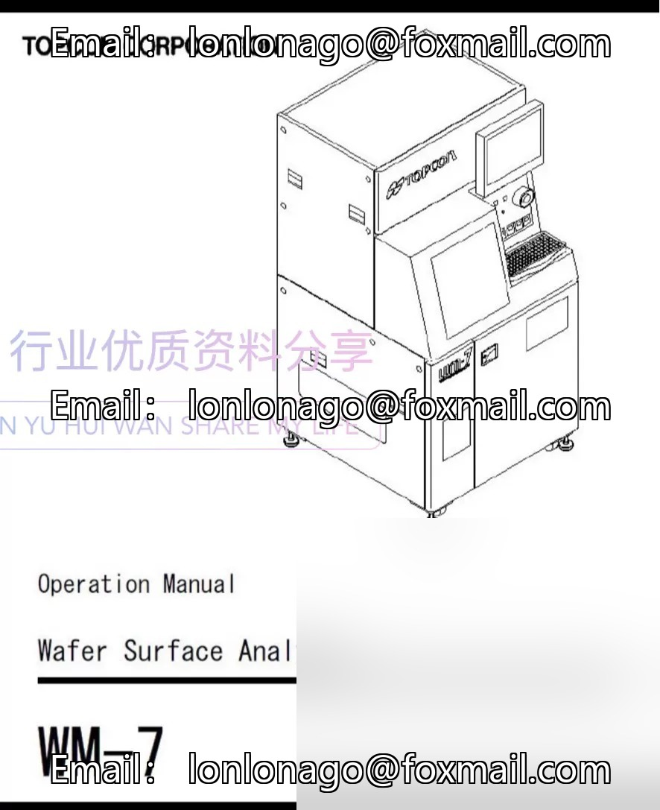
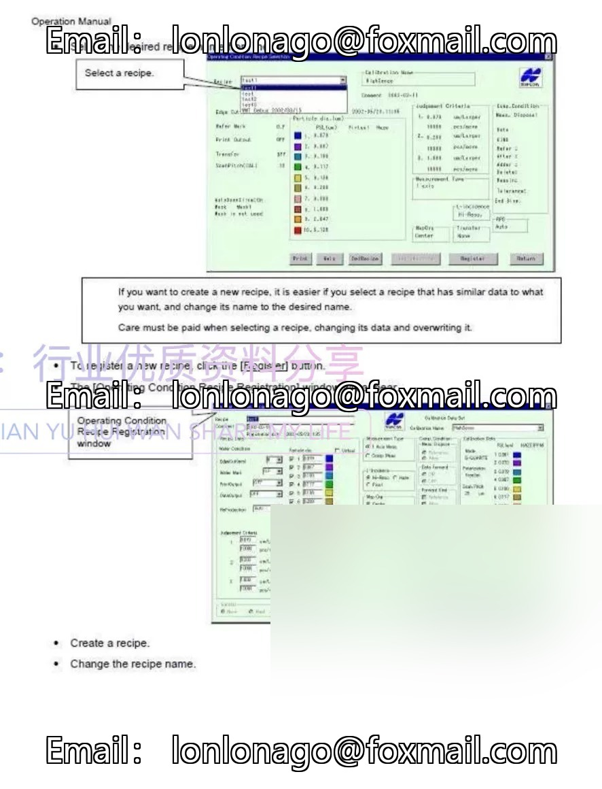
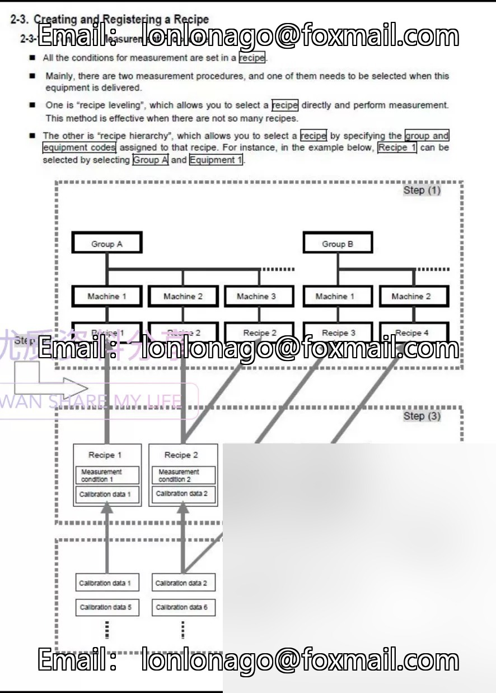
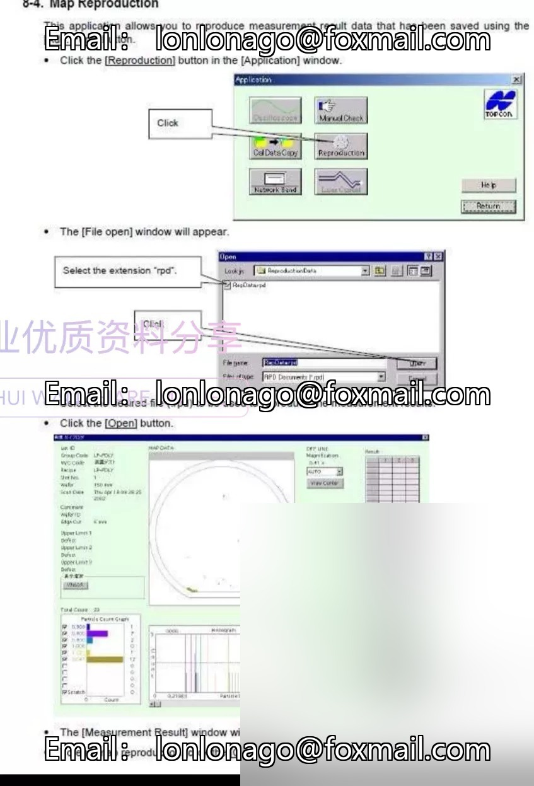
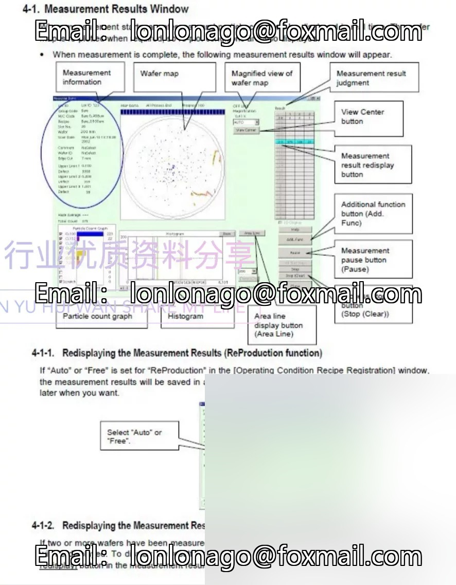
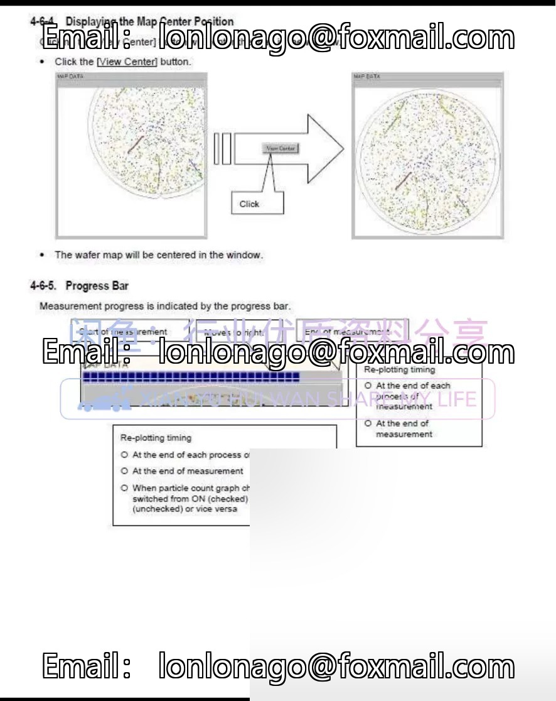

# Japanese TOPCON WM7 wafer surface particle inspection apparatus (8-inch) technical manual

## Body

Japanese TOPCON WM7 wafer surface particle inspection device (8-inch) technical manual (including operation detailed explanation), with large reference value, exceeding 140 pages.

Capture and send the electronic original directly! The following images include screenshots of the file portion. Please confirm before placing the order! Due to the replicable nature of electronic documentation Therefore, are allowed after purchase! Thanks for understanding!

For personal learning and reference use only!

This is the TOPCON WM7 wafer surface particle inspection device (8-inch) technical manual covering operation details, with 140-plus pages of value; relevant images and parameters are also included.

<!-- AI_ENRICHED -->

## Images

## Payment

Here is a pay link on Stripe ( https://buy.stripe.com/3cs8yP7sY87d0vu9AB ). Please contact me lonlonago@foxmail.com after funding $89, and I will send you a complete data files , thank you!

